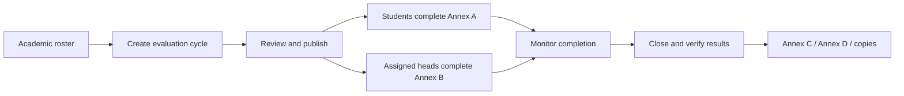

# System audit and simplification proposal

Audit date: 22 October 2026. Scope: current Laravel/Filament code, existing regression suite, read-only checks against the running sample campus, and sample chairperson UI. This document proposes revisions; it does not represent fixes already implemented.

## Decision summary

Organize the application around a guided evaluation cycle, with academic data entered once and reports generated from one calculation pipeline. Keep the existing Laravel/Filament foundation. The highest-value work is correcting inconsistent behavior, defining explicit organizational access, and reducing duplicate workflows.

The current confusion has identifiable causes:

- Evaluation Results and Evaluation Reports are separate implementations with different scoring behavior.
- Students can be imported from both Users and Academic Students, using different authorization and update rules.
- A course offering serves academic enrollment, assessment delivery, evaluation assignment, and supervisor evaluation tasks.
- Important state is implicit: supervisor tasks are created when a page opens; published form definitions remain editable; section membership lacks an academic period.
- Student roster management depends on general account-management permissions, which also expose role editing.
- The dashboard can provide little actionable information to a chairperson despite a long sidebar.

## Verification results and limits

- Full existing test suite: **335 passed, 4 failed, 1,410 assertions**, about 87 seconds. SQLite in-memory testing was used; the live campus database was not reset or seeded.
- Failures: BalilihanSampleDataTest (sample dean report access), EvaluationTypeTest (report access), and two FacultyTemplatesTest cases (report access). Several fixtures assume campus membership plus report permission is sufficient, which conflicts with the newer assignment rules. The sample dean is also currently blocked. Resolve the intended reviewer assignment explicitly; do not weaken access checks merely to make tests pass.
- Live sample chairperson UI: the dashboard offers a general workspace link and Reset Order, while Reports exposes five overlapping destinations. Academic Students is absent for this sample role because it lacks the broad user-management permission currently required by that resource.
- Live Student Evaluation Progress shows 0 out of 0 for a sample student whose correct eligible assignments and completed responses are **2 out of 2**. This was independently verified using qualified offering columns without changing records.
- Read-only code review identified additional authorization, reporting, evidence-retention, assessment, and recovery defects. Attack requests were not executed; SQL-workspace session lifetime and recovery risks are code-based findings, not a live penetration or restore test.
- No application behavior, permissions, or student records were changed during this audit. A sample-account login and read-only page navigation were used. This report and a screenshot are audit artifacts.

## Fix before the next presentation

### A1. Correct student progress counts — high priority, reproduced live

`StudentEvaluationProgress::counts()` converts the many-to-many relationship into its underlying query and calls get() with an unqualified SELECT *. Joined pivot columns can overwrite CourseOffering attributes.

Observed sample: raw joined record had id 78 and evaluatee user_id 47; selecting course_offerings.* produced offering id 12 and evaluatee user_id 45. The corrupted identity is rejected by the enrollment/access check, producing 0/0. Correctly hydrated offerings yield 2 completed of 2 eligible.

Revision: explicitly select course_offerings.* or preserve the relationship's qualified hydration. Add regression data where pivot IDs differ from offering IDs and a student has multiple offerings. Verify the list and each individual count use the same assignment context.

Evidence: [StudentEvaluationProgress.php:30](<C:/Users/front/Documents/ChatGPT/EVALUATION AND QUIZ MANAGEMENT SYSTEM/app/Services/StudentEvaluationProgress.php:30>). Screenshot: [sample progress page](<C:/Users/front/Documents/ChatGPT/EVALUATION AND QUIZ MANAGEMENT SYSTEM/storage/app/qa/deep-audit-progress-before.png>).

### A2. Use one scoring service and explicit score units — high priority

ReportService returns a raw total for a sum-configured form, combines assignment scores, and uses the first form's rating scale to label the result. An Annex response total such as 60 out of 75 is compared to a five-point scale. Even low Annex totals can therefore receive the highest label. A live sample summary returned avg_score 71.25 with the label Always manifested, without communicating the /75 unit.

The Annex C controller instead excludes incomplete responses, converts totals to percentages, and keeps SET and SEF separate. Different report pages can contradict one another.

Revision: one calculator returns answered count, completeness, raw total / maximum, mean /5, percentage /100, instrument, and interpretation. Every dashboard, table, modal, PDF/print and CSV must use it. Keep SET and SEF separate. Do not introduce a combined overall score until an approved weighting rule exists.

Evidence: [ReportService.php:44](<C:/Users/front/Documents/ChatGPT/EVALUATION AND QUIZ MANAGEMENT SYSTEM/app/Services/ReportService.php:44>), [ReportService.php:137](<C:/Users/front/Documents/ChatGPT/EVALUATION AND QUIZ MANAGEMENT SYSTEM/app/Services/ReportService.php:137>), [FacultyReportController.php:54](<C:/Users/front/Documents/ChatGPT/EVALUATION AND QUIZ MANAGEMENT SYSTEM/app/Http/Controllers/FacultyReportController.php:54>).

### A3. Apply filters to calculations, exports, and visiting faculty — high priority

The Evaluation Reports filters select faculty rows using matching assignments, but summary callbacks still request all semesters/forms. Export CSV rebuilds an unfiltered query. Avg Score sorting returns the existing query without sorting. Department summaries exclude some real visiting instructors and can aggregate a home-department faculty member's courses from other teaching departments.

Revision: one report context contains campus, authorized departments, academic period, instrument and applied filters. Carry it through list, statistics, drill-down, export and print. Define department reports by the teaching department on each assignment.

Evidence: [EvaluationReportResource.php:142](<C:/Users/front/Documents/ChatGPT/EVALUATION AND QUIZ MANAGEMENT SYSTEM/app/Filament/Resources/EvaluationReportResource.php:142>), [:208](<C:/Users/front/Documents/ChatGPT/EVALUATION AND QUIZ MANAGEMENT SYSTEM/app/Filament/Resources/EvaluationReportResource.php:208>), [:254](<C:/Users/front/Documents/ChatGPT/EVALUATION AND QUIZ MANAGEMENT SYSTEM/app/Filament/Resources/EvaluationReportResource.php:254>), [ReportService.php:281](<C:/Users/front/Documents/ChatGPT/EVALUATION AND QUIZ MANAGEMENT SYSTEM/app/Services/ReportService.php:281>).

### A4. Make campus-wide authority explicit — high priority

AssignedDataAccess treats view_any_user plus update_user, with no department assignment, as campus-wide administration. User editing can clear instructor_department_id. For a department staff member who is not also a configured head, clearing that profile field can expand their visibility on the next request. General user editing also exposes existing campus roles without a separate privileged-role-grant check.

Revision: explicit campus administrator assignments, explicit department memberships, and a separate role-grant permission. Unassigned ordinary staff receive no department data. Removing a profile department must never increase authority. Preserve the established super-admin exception. Add an Effective Access preview: campus, departments, role capabilities, and why each scope applies.

Evidence: [AssignedDataAccess.php:24](<C:/Users/front/Documents/ChatGPT/EVALUATION AND QUIZ MANAGEMENT SYSTEM/app/Services/AssignedDataAccess.php:24>), [:32](<C:/Users/front/Documents/ChatGPT/EVALUATION AND QUIZ MANAGEMENT SYSTEM/app/Services/AssignedDataAccess.php:32>), [UserResource.php:112](<C:/Users/front/Documents/ChatGPT/EVALUATION AND QUIZ MANAGEMENT SYSTEM/app/Filament/Resources/UserResource.php:112>), [:170](<C:/Users/front/Documents/ChatGPT/EVALUATION AND QUIZ MANAGEMENT SYSTEM/app/Filament/Resources/UserResource.php:170>).

### A5. Close legacy access and evidence paths — high priority

- Old queued student/instructor imports resolve accounts globally, attach them to another campus, and synchronize their roles. They run outside the panel's request scope. Retire these duplicate entry points and use one explicitly authorized import service that rechecks the operator's assignments inside the job.
- Direct /form-preview checks campus membership but omits the department scope used by other endpoints.
- The old form submissions table/modal can expose legacy names and IPs without the identity-reveal permission.
- Form submissions expose delete and bulk-delete actions. FormSubmission has no dedicated policy; the installed Filament helper allows missing policies. Form editors should not have routine destructive access to evaluation evidence.

Revision: centralize anonymous respondent presentation and identity authorization, add an explicit submission policy and audit trail, and replace routine deletion with authorized void/reopen actions. Apply organizational scope to every direct endpoint and queued import.

Evidence: [StudentImporter.php:166](<C:/Users/front/Documents/ChatGPT/EVALUATION AND QUIZ MANAGEMENT SYSTEM/app/Filament/Imports/StudentImporter.php:166>), [InstructorImporter.php:177](<C:/Users/front/Documents/ChatGPT/EVALUATION AND QUIZ MANAGEMENT SYSTEM/app/Filament/Imports/InstructorImporter.php:177>), [EvaluationController.php:146](<C:/Users/front/Documents/ChatGPT/EVALUATION AND QUIZ MANAGEMENT SYSTEM/app/Http/Controllers/EvaluationController.php:146>), [SubmissionsRelationManager.php:31](<C:/Users/front/Documents/ChatGPT/EVALUATION AND QUIZ MANAGEMENT SYSTEM/app/Filament/Resources/FormResource/RelationManagers/SubmissionsRelationManager.php:31>), [:72](<C:/Users/front/Documents/ChatGPT/EVALUATION AND QUIZ MANAGEMENT SYSTEM/app/Filament/Resources/FormResource/RelationManagers/SubmissionsRelationManager.php:72>).

### A6. Freeze instruments once responses exist — high priority

The form builder can edit or delete question definitions while historical reports and individual copies use the current field definitions. This can change the meaning, completeness and scoring of answers already submitted.

Revision: Draft -> Published -> Archived. Published instruments with responses are immutable. Editing creates a new version; assignments and submissions retain the original version. Preview the published layout before opening a cycle. Rename builder Section to Criteria Group to distinguish it from a student's class section.

Evidence: [FormBuilder.php:388](<C:/Users/front/Documents/ChatGPT/EVALUATION AND QUIZ MANAGEMENT SYSTEM/app/Filament/Pages/FormBuilder.php:388>), [:465](<C:/Users/front/Documents/ChatGPT/EVALUATION AND QUIZ MANAGEMENT SYSTEM/app/Filament/Pages/FormBuilder.php:465>).

## Simpler information architecture

| Main menu | Contents and purpose |
| --- | --- |
| Home | Role-specific tasks, readiness warnings and current-cycle progress |
| Academic Management | Departments and heads; academic periods; students and multiple class sections; teaching classes |
| Faculty Evaluation | Cycles, monitoring, one Results & Reports workspace; official templates under setup |
| Assessments | Quizzes/exams/activities; conduct session; grading; class records |
| Administration | Staff accounts, Access & Assignments, system health, backups and settings |

Show only authorized menus. A student needs My Evaluations and My Assessments. A chairperson needs their department's pending tasks and monitoring. Faculty need their teaching classes and released results. A registrar needs Students & Sections without access to staff roles. A reviewer needs scoped reports without edit privileges.

Each page should show a persistent context strip such as Balilihan / CCIS / First Semester 2026-2027. Department staff cannot select another department merely by editing a filter. Provide a clear message when assignments are missing; distinguish No permission, No matching data, No students assigned and No responses yet.

## Recommended evaluation workflow

1. Choose the academic period once. Confirm the department's supervisor and chairperson.
2. Import or update students under their home department. Allow multiple section memberships for irregular students. Keep the year within the section name, as requested; no separate year-level input is needed.
3. Create an Evaluation Cycle. Pick official instrument versions, faculty/teaching classes, sections, extra students and exclusions.
4. Show a roster preview before publishing: selected groups, unique student count, additions, exclusions and unresolved IDs. Make Add to roster and Replace roster explicit. Preserve submitted responses independently.
5. Show one readiness checklist: departments/heads, forms, roster, opening/closing dates, evaluator counts and access scope.
6. Publishing creates the supervisor tasks explicitly. Opening a page should not silently create old-semester assignments.
7. Monitoring distinguishes Not yet open, Open/incomplete, Completed, Closed/incomplete and Unavailable. Follow-up flags should correspond to work the student can currently complete.
8. Use one faculty results workspace with tabs: Overview, SET, SEF, Anonymous Tally, Response Copies, Annex C and Annex D. Print/Save PDF remains in the in-system preview modal.
9. Close and archive the cycle. Retain an auditable snapshot of instruments, assignments, responses and released reports.

## Academic data revisions

Keep one student account per ID. Replace permanent free-text section tags with section memberships tied to an academic period, while preserving multiple memberships. A new-semester upload must not silently keep last semester's section assignments. Offer an import preview with new/updated/unchanged/conflicting rows and clear error downloads.

Separate teaching classes from evaluation assignments. A teaching class contains course, faculty, department, period and roster; assessments and SET evaluation assignments can reuse it. An SEF task belongs to a faculty member and teaching department and should not need a placeholder student course. This is a planned model improvement, not a request to overwrite current records.

Use dedicated capabilities: manage_student_profiles, import_students, manage_section_memberships, manage_evaluation_assignments, conduct_supervisor_evaluation, view_progress, view_results, print_reports, reveal_evaluator_identity, manage_staff_accounts and assign_roles. Map them to understandable role presets and assigned scopes.

## Assessment and server revisions before a campus pilot

### B1. Finalize expired attempts on the server

Expiry currently depends on browser mount/poll/write paths. A closed browser can leave a timed-out attempt in_progress. Use one idempotent finalization service and a scheduled expiry sweep. Show Timed out — submitted automatically. Evidence: [TakeQuiz.php:457](<C:/Users/front/Documents/ChatGPT/EVALUATION AND QUIZ MANAGEMENT SYSTEM/app/Filament/Pages/TakeQuiz.php:457>), [:670](<C:/Users/front/Documents/ChatGPT/EVALUATION AND QUIZ MANAGEMENT SYSTEM/app/Filament/Pages/TakeQuiz.php:670>), [console.php:13](<C:/Users/front/Documents/ChatGPT/EVALUATION AND QUIZ MANAGEMENT SYSTEM/routes/console.php:13>).

### B2. Protect SQL submission evidence

Snapshot export errors are logged while submission proceeds. Grading can fall back to a live database. Existing phpMyAdmin sessions are not reliably coupled to attempt closure. Cleanup can drop a completed workspace without verifying a successful snapshot.

Use Snapshot pending / ready / failed, retries, immutable evidence, workspace write revocation at closure, and prune only after verified export. Evidence: [TakeQuiz.php:578](<C:/Users/front/Documents/ChatGPT/EVALUATION AND QUIZ MANAGEMENT SYSTEM/app/Filament/Pages/TakeQuiz.php:578>), [StudentDatabaseCommand.php:71](<C:/Users/front/Documents/ChatGPT/EVALUATION AND QUIZ MANAGEMENT SYSTEM/app/Console/Commands/StudentDatabaseCommand.php:71>), [signon.php.stub:18](<C:/Users/front/Documents/ChatGPT/EVALUATION AND QUIZ MANAGEMENT SYSTEM/resources/student-db/signon.php.stub:18>).

### B3. Approve a specific waiting browser

Approving a student updates all pending requests for that user ID. Multiple browsers entering the same ID can be admitted together. Display individual requests with a short verification code and approve selected request IDs. Keep global PIN recovery in account management. Evidence: [StudentSignIns.php:69](<C:/Users/front/Documents/ChatGPT/EVALUATION AND QUIZ MANAGEMENT SYSTEM/app/Services/StudentSignIns.php:69>).

### B4. Use clear assessment stages

Recommended stages: Class -> Details -> Questions -> Participants -> Publish -> Conduct -> Grade -> Release -> Export/Sync. Use Awaiting instructor grading for essays, coding and file uploads. Explain the current exam export limitations instead of implying all assessment types support the same class-record sync. Keep evaluation ID entry free of instructor PIN approval, as already requested.

### B5. Prove recovery and server reliability

The current daily ZIP does not by itself prove a full new-machine recovery. Encrypted evaluator identities and student DB credentials require the original application key; live SQL workspaces also need a backup policy. Provide secure key recovery guidance and rehearse restore in an empty environment. Never print secrets in logs or the audit report. Replace predictable imported-instructor passwords with individual one-time access.

A desktop-host background worker exit can stop the entire host; evaluate the active campus launcher separately before applying that finding to deployment. Keep core evaluation access available when recoverable queue/live-update/database-helper services fail. Add health status and bounded restarts, plus a campus-sized concurrency test. No campus capacity claim is established by this audit.

Evidence: [BackupCommand.php:40](<C:/Users/front/Documents/ChatGPT/EVALUATION AND QUIZ MANAGEMENT SYSTEM/app/Console/Commands/BackupCommand.php:40>), [InstructorImporter.php:219](<C:/Users/front/Documents/ChatGPT/EVALUATION AND QUIZ MANAGEMENT SYSTEM/app/Filament/Imports/InstructorImporter.php:219>), [host.cjs:100](<C:/Users/front/Documents/ChatGPT/EVALUATION AND QUIZ MANAGEMENT SYSTEM/desktop-host/resources/server/host.cjs:100>).

## UI revisions that reduce daily confusion

- Replace the chairperson's mostly empty home page with Pending supervisor evaluations, SET completion, Students needing follow-up and Review reports.
- Merge overlapping results/report destinations into one faculty workspace; put printing and copies beside the results they belong to.
- Keep Students in Academic Management. Remove the duplicate student importer from general Users once its functionality has been migrated safely.
- Use Criteria Groups in templates and Class Sections in rosters. Use Student Evaluation (Annex A / SET) and Supervisor Evaluation (Annex B / SEF) consistently.
- Keep common filters visible and retain one selected period as users navigate. Every export should state the same filters and score units.
- Separate ordinary template editing from advanced scale/scoring configuration. Hide implementation fields such as URL slug from normal operators.
- Use specific empty states and a next action. No active assignments should not be used when a query or permission defect caused missing data.
- Make a staff login return to a valid authorized page if a stale intended URL is no longer accessible. During the sample login, a stale department-edit destination produced a 404 before navigating home.
- Light is configured as the default, but the observed sample browser still rendered dark. Existing saved theme choice may be involved; verify stored/system-theme migration and first-load behavior against the desired light-first rule before changing appearance again.

## Suggested implementation order and acceptance checks

1. Correct progress hydration, report calculations/filtering/export and department aggregation. Acceptance: the same scoped data produces the same totals and units in every screen, CSV and Annex print.
2. Make scope assignments explicit; close import/preview/identity/deletion/role-edit gaps. Acceptance: denied cross-campus/cross-department URLs, queue jobs and exports; removing a profile field never increases access.
3. Freeze published instruments and define the evaluation-cycle lifecycle. Acceptance: historical copies do not change when a new template version is edited.
4. Consolidate navigation and build the guided cycle/monitor/results workspace. Acceptance: a chairperson can set up, monitor and print a complete sample cycle without visiting general account settings.
5. Add academic-period section membership and a roster preview. Acceptance: an irregular student in two selected sections appears once; new-period imports do not retain obsolete membership silently.
6. Harden assessment finalization, SQL evidence, request-specific sign-on and recovery. Acceptance: closed-browser expiry, failed snapshots, active DB sessions after closure and full restore are covered by integration checks.

Keep existing working capabilities: no evaluation PIN approval, campus/department isolation, irregular-student multiple sections, section exceptions, separate SET/SEF, anonymous tally, authorized identity reveal, and modal selected/bulk printing. The aim is fewer decisions per task and one consistent source of truth.
